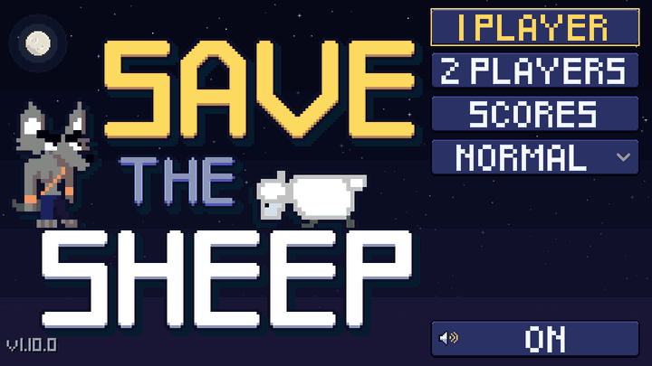

# Save the Sheep — page itch.io

Généré par `generate_itchio.sh` : ne pas modifier à la main, régler les variables du script.

## Thème (Edit theme)

| Champ | Valeur |
|---|---|
| **BG** | `#0e1025` |
| **BG 2** | `#181b3f` |
| **Text** | `#ececec` |
| **Link** | `#ffd34d` |
| **Font** | Lato |
| **Size** | Large |
| **Screenshots** | Sidebar |
| **Banner** | `banner.png` |
| **Background** | aucune (couleur BG) |
| **Embed BG** | `embed_bg.png` |
| **Embed BG – Color 1** | `#0e1025` |
| **Embed BG – Color 2** | `#181b3f` |
| **Embed BG – Alpha** | 100 % (curseur à droite) |

## Images

| Fichier | Où |
|---|---|
| `cover.png` (630x500) | Edit game → Cover image |
| `banner.png` (960x300) | Edit theme → Banner |
| `embed_bg.png` | Edit theme → Embed BG |
| captures `export/Linux/screenshots/` | Edit game → Screenshots |

## Texte (EN)

**Short description / tagline :** Protect the sheep, solo or 2 players co-op

**Description** (éditeur itch.io en mode HTML) :

```html
<h1>🐑 Save the Sheep</h1>
<p><strong>An arcade action game where you keep the sheep alive to finish every level, alone or with a friend.</strong></p>
<p>👥 <strong>New: 2 players co-op on the same screen!</strong></p>
<p></p>
<p>Gordon has one job: <strong>protect the sheep</strong>. The sheep walks on its own, and Gordon has to clear the way so it can reach the end of each level in one piece.</p>
<p>If the sheep doesn't make it, neither do you! 🐾</p>
<hr>
<h2>✨ Features</h2>
<ul>
  <li>🌃 <strong>A city at night</strong>: run and jump across rooftops, streets and building sites under a starry sky</li>
  <li>💦 <strong>Water gun</strong>: blast the enemies (dinosaurs included!) before they reach the sheep</li>
  <li>🚪 <strong>Action handle</strong>: open gates to let the sheep through</li>
  <li>🛗 <strong>Elevators</strong>: turn them on to carry the sheep over obstacles</li>
  <li>🏍️ <strong>Bonus level</strong>: ride the motorbike, jump the rocks and grab water and desserts before time runs out</li>
  <li>👥 <strong>2 players co-op</strong>: play together on the same screen, each player with his own life bar; gates and elevators only move once both players pull the handle, and the bonus level gets two motorbikes on two roads</li>
  <li>👶 <strong>For everyone</strong>: suitable from age 3</li>
</ul>
<h2>🎮 Controls</h2>
<p><strong>1 player</strong></p>
<ul>
  <li><strong>← →</strong>: move</li>
  <li><strong>Space / Z</strong>: jump</li>
  <li><strong>Enter / A</strong>: shoot</li>
  <li><strong>Tab / E</strong>: action (gates, elevators)</li>
  <li><strong>Esc</strong>: pause</li>
  <li><strong>M</strong>: sound on / off</li>
</ul>
<p><strong>2 players</strong> (shared keyboard)</p>
<table>
  <tr><th></th><th>Player 1</th><th>Player 2</th></tr>
  <tr><td>Move</td><td>Q D (A D on QWERTY)</td><td>← →</td></tr>
  <tr><td>Jump</td><td>Z (W on QWERTY)</td><td>↑</td></tr>
  <tr><td>Shoot</td><td>F</td><td>L</td></tr>
  <tr><td>Action</td><td>G</td><td>K</td></tr>
</table>
<p>After <strong>1 PLAYER</strong> or <strong>2 PLAYERS</strong> in the menu, each player picks keyboard or gamepad, can change his keys and try them in the test area before <strong>START</strong>.</p>
<p>🕹️ Gamepads are supported too, and touch screens get on-screen controls.</p>
<hr>
<h2>🐧 Also on Linux</h2>
<ul>
  <li>📦 <a href="https://flathub.org/apps/org.dupot.savethesheep">Flathub</a> (x86_64 &amp; aarch64): <code>flatpak install flathub org.dupot.savethesheep</code></li>
  <li>🧩 <a href="https://snapcraft.io/dupot-save-the-sheep">Snap Store</a>: <code>sudo snap install dupot-save-the-sheep</code></li>
</ul>
<h2>💻 Free &amp; open source</h2>
<p>Made with <a href="https://godotengine.org">Godot 4.7</a>, under the LGPL-2.1 license. The source code is on <a href="https://github.com/imikado/dupotSaveTheSheep">GitHub</a>: bug reports and ideas are welcome in the <a href="https://github.com/imikado/dupotSaveTheSheep/issues">issues</a>.</p>
<p>🕹️ More games by Dupot on <a href="https://dupot-org.itch.io">itch.io</a> and <a href="https://www.dupot.org/games.html">dupot.org</a>.</p>
```
